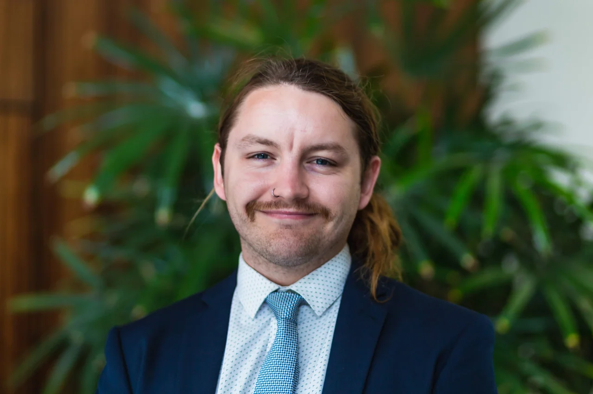
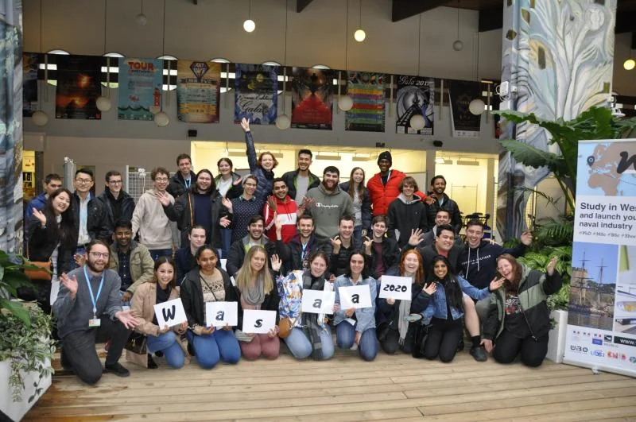
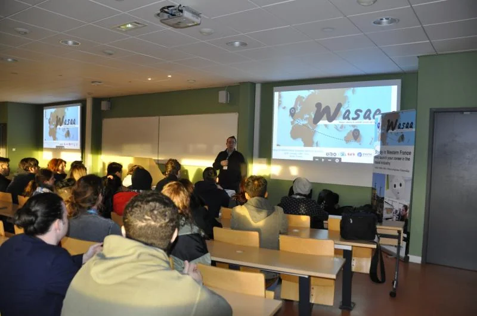
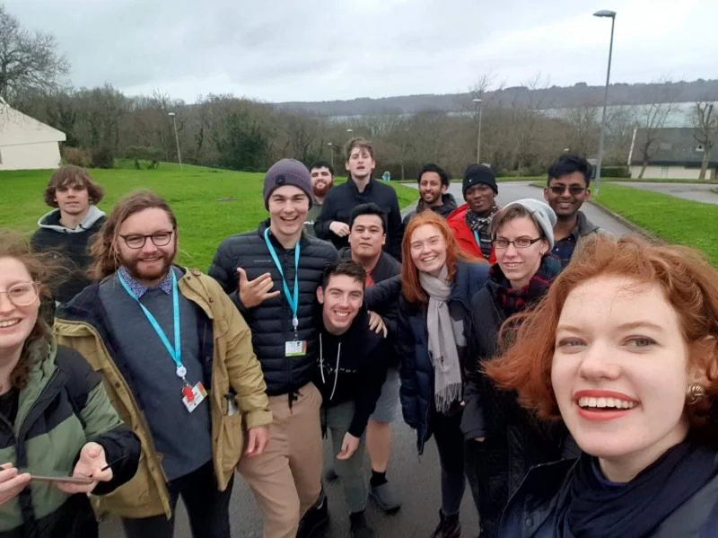
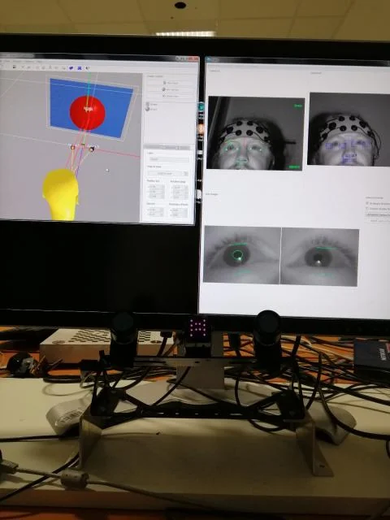

```{=html}
<header class="page-hero container"><p class="eyebrow">A little more about me</p><h1>About me</h1><p class="lead">I’m Steve, a researcher and engineer based in Brisbane. I work at QUT and co-founded Panalogy Lab, an independent applied AI research and development company.</p></header>
<section class="container about-intro" aria-labelledby="about-heading"><div><h2 id="about-heading">Engineering, economics<br>and a few turns along the way</h2><p>My background brings together electrical engineering, economics and hands-on project delivery. Before my current research and applied AI work, I worked on industrial automation, control systems, functional safety and multidisciplinary engineering projects.</p><p>During my PhD in Economics, I studied how people and complex systems respond to change. My current work often brings the two backgrounds together: studying behaviour while building the software needed to investigate it.</p></div><figure><figcaption>Engineering days, with a Movember moustache for men’s health.</figcaption></figure></section>
<div class="container reading-layout">
  <aside class="page-aside"><p class="eyebrow">My background</p><nav aria-label="On this page"><a href="#journey">Experience &amp; roles</a><a href="#education">Education</a><a href="#international">Learning across borders</a><a href="#recognition">Selected recognition</a><a href="#service">Service &amp; contribution</a><a href="#contact">Get in touch</a></nav><p class="aside-note">For the full research record, visit <a href="publications.html">publications</a>.</p></aside>
  <div class="prose">
    <section class="prose-section" id="journey"><p class="eyebrow">Professional experience</p><h2>Experience and current roles</h2><ul class="timeline"><li><time>2023–now</time><div><h3>Postdoctoral Research Fellow · QUT</h3><p>Applied AI, behavioural economics and computational research with the ARC Training Centre for Behavioural Insights for Technology Adoption. Executive Committee member and co-founder / coordinator of the ARC BITA Geek Seminar Series.</p></div></li><li><time>2023–now</time><div><h3>Co-Founder &amp; CEO · Panalogy Lab</h3><p>Independent applied AI R&amp;D, spanning research and product strategy, hands-on prototyping, requirements, evaluation, industry engagement and delivery.</p></div></li><li><time>2018–2023</time><div><h3>Engineering &amp; project delivery · AEP Elical</h3><p>Electrical Engineer and Project Manager, with concurrent HSEQ leadership (2019–2022) and Nyrstar client relationship management (2021–2023). Industrial automation, control systems, functional safety and multidisciplinary delivery.</p></div></li><li><time>2017–2023</time><div><h3>Research Assistant · QUT</h3><p>Research in the School of Economics and Finance, alongside engineering and economics study and professional practice.</p></div></li><li><time>2015–2018</time><div><h3>Program Leader · AFL Queensland</h3><p>Program leadership, sports coaching and supervision in the Brisbane and Ipswich area · January 2015–November 2018.</p></div></li></ul><p>I also contribute as a <strong>Fellow Investigator with QUT’s Energy Transition Centre</strong> and an <strong>Associate Investigator with QUT’s Centre for Data Science</strong>.</p></section>
    <section class="prose-section" id="education"><p class="eyebrow">Academic foundations</p><h2>Education</h2><ul class="timeline"><li><time>2020–2023</time><div><h3>PhD in Economics</h3><p>Queensland University of Technology<br><em>Bridging Complexity and Behavioural Economics: The Constrained Methods Matrix.</em> <a href="https://doi.org/10.5204/thesis.eprints.244769">Read the thesis ↗</a></p></div></li><li><time>2015–2019</time><div><h3>Bachelor of Engineering (Electrical)</h3><p>Queensland University of Technology · Honours Class 2A<br>Honours project: gesture recognition for human–machine interaction.</p></div></li><li><time>2015–2019</time><div><h3>Bachelor of Business (Economics)</h3><p>Queensland University of Technology · Distinction</p></div></li></ul></section>
    <section class="prose-section" id="international"><p class="eyebrow">Experiences that shaped my work</p><h2>Learning across borders</h2><h3>Vietnam · Research and higher education exchange</h3><p>From 3–24 October 2024, I visited co-authors and prospective collaborators in Ho Chi Minh City and Hanoi, including the Institute of Smart City and Management at the University of Economics Ho Chi Minh City, RMIT’s Hanoi and Saigon South campuses, and SEAMEO RETRAC, where I facilitated invited conference panels.</p><p>I also met international education and collaboration organisations, including representatives of RMIT Melbourne, the British Columbia Council for International Education, the Canadian Bureau for International Education, and Colleges and Institutes Canada. An industry site visit to EoH explored its work on Internet of Things platforms, hardware integration and cloud services. <a href="teaching.html#speaking">Panel titles and speaking engagements →</a></p><h3>France · WASAA 2020 at IMT Atlantique</h3><p>I was one of 24 Australian students selected for the program in Brest, France, in January–February 2020. The three-week program combined technology, language and cultural learning.</p><p>In the Human Factors strand, I explored human–machine relationships through bioinformatics, crisis management, leadership modelling and cognitive decision-making. I also contributed to a PhD study in flight operator cognitive state modelling, working with an aviation multitask environment and presenting the findings.</p>
<div class="event-gallery event-gallery--wasaa">
<figure><a class="photo-link" href="assets/images/events/wasaa-1.webp" data-figure-title="WASAA 2020 · IMT Atlantique" aria-label="Enlarge: WASAA 2020 · IMT Atlantique"></a><figcaption>The WASAA 2020 cohort at IMT Atlantique · Brest, France</figcaption></figure>
<figure><a class="photo-link" href="assets/images/events/wasaa-2.webp" data-figure-title="Learning at WASAA 2020" aria-label="Enlarge: Learning at WASAA 2020"></a><figcaption>Technology and research sessions during the three-week program · 2020</figcaption></figure>
<figure><a class="photo-link" href="assets/images/events/wasaa-3.webp" data-figure-title="Friends and fellow participants · WASAA 2020" aria-label="Enlarge: Friends and fellow participants · WASAA 2020"></a><figcaption>Friends and fellow participants in Brest · WASAA 2020</figcaption></figure>
<figure><a class="photo-link" href="assets/images/events/wasaa-4.webp" data-figure-title="Human Factors research · WASAA 2020" aria-label="Enlarge: Human Factors research · WASAA 2020"></a><figcaption>A closer look at the Human Factors research environment · WASAA 2020</figcaption></figure>
</div>
<h3>China · Huawei and the Australian Technology Network</h3><p>One of 29 Australian students selected for a 2018 program in Shenzhen combining language and cultural study with training in 5G, the Internet of Things, communications and networking.</p><h3>The Netherlands · Delft University of Technology</h3><p>During a 2017–2018 exchange, I completed engineering coursework and a research project investigating how environmental design and perceived effort could encourage cycling.</p></section>
    <section class="prose-section" id="recognition"><p class="eyebrow">Selected achievements</p><h2>Selected awards</h2><ul><li><strong>2023/2024:</strong> BEST / ACHLR Early Career Researchers Award.</li><li><strong>2022:</strong> Caleb Lo HDR Award, co-awarded with Elcin Tuzel at the Fourth Annual BEST Conference on Human Behaviour and Decision Making.</li><li><strong>2019:</strong> Economic Society of Australia Queensland Academic Prize.</li><li><strong>2019:</strong> Institute of Engineering and Technology Present Around the World, Queensland winner.</li><li><strong>2018:</strong> second place with my team at the Australian Nudgeathon.</li><li><strong>2017:</strong> Nudgeathon People’s Choice Award.</li><li><strong>2015–2019:</strong> multiple Dean’s List recognitions across QUT Engineering and Business.</li></ul><p><a href="teaching.html#nudgeathon">From Nudgeathon competitor to mentor and coach →</a></p></section>
    <section class="prose-section" id="service"><p class="eyebrow">Contributing to the community</p><h2>Service and contribution</h2><p>I serve on the ARC BITA Executive Committee and co-founded its Geek Seminar Series and public research resources hub. I represented early-career researchers from QUT’s Faculty of Business and Law on the University Research Committee in 2023–2024.</p><p>My community work includes Nudgeathon coaching, research mentoring, school outreach and the Mansfield State High School Digital Solutions Mentorship Program. Earlier roles included student engineering society leadership and membership of Brisbane Central Lions Club.</p><details class="service-reviewing"><summary>Peer review <span>14 journals and research platforms</span></summary><p>I have reviewed for the following journals and research platforms:</p><ul class="reviewing-list"><li>Applied Economics</li><li>BMC Public Health</li><li>Futures</li><li>Heliyon</li><li>International Journal of Health Policy and Management</li><li>Journal of Computational Social Science</li><li>Journal of Economic Surveys</li><li>Kyklos</li><li>Nature Communications</li><li>Oxford Economic Papers</li><li>Psychology &amp; Marketing</li><li>Qeios</li><li>Review of Managerial Science</li><li>Scientific Reports</li></ul></details><h3>Board and advisory opportunities</h3><p>I’m open to board and advisory roles with private companies, not-for-profit organisations and research or community bodies, particularly where my experience in AI, technology adoption, engineering and research can contribute. <a href="#contact">Get in touch about a board or advisory role →</a></p></section>
    <section class="prose-section" id="contact"><p class="eyebrow">Get in touch</p><h2>Contact</h2><p>I welcome conversations about research collaborations, teaching, supervision, speaking engagements and practical applications of AI.</p><div class="contact-grid"><div class="contact-card"><h3>Research &amp; academic enquiries</h3><p>Collaborations, teaching, supervision and research training.</p><a href="mailto:s.bickley@qut.edu.au">s.bickley@qut.edu.au</a></div><div class="contact-card"><h3>Panalogy Lab enquiries</h3><p>Independent commercial applied AI research, development and advisory work.</p><a href="mailto:steve@panalogy-lab.com">steve@panalogy-lab.com</a></div></div></section>
  </div>
</div>
```
