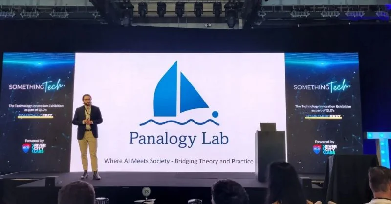
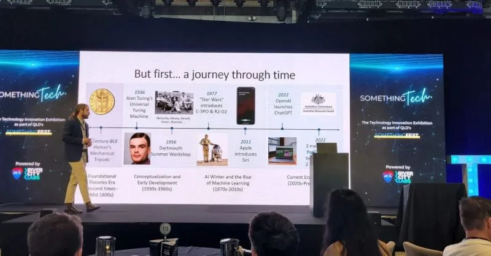
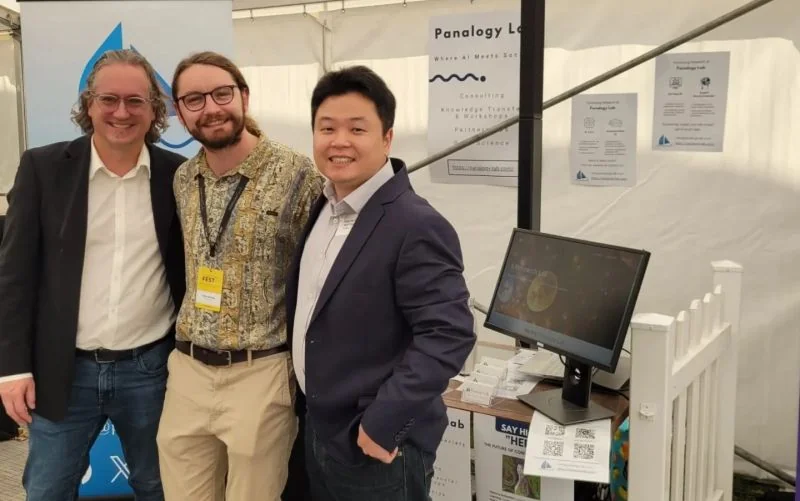
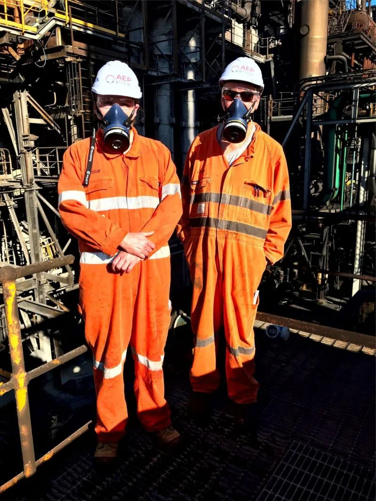

```{=html}
<header class="page-hero container"><p class="eyebrow">Research in practice</p><h1>Projects</h1><p class="lead">A selection of research projects, software and engineering work I have led or contributed to. Each entry describes my role and what the team delivered.</p><div class="page-jumps"><a href="#ai-adoption">Public sector research</a><a href="#knowledge-platforms">Research software</a><a href="#surveylm">Panalogy Lab</a><a href="#engineering">Engineering</a></div></header>
<div class="container reading-layout">
  <aside class="page-aside"><p class="eyebrow">Selected projects</p><nav aria-label="On this page"><a href="#ai-adoption">AI adoption &amp; workforce capability</a><a href="#knowledge-platforms">Archival &amp; scientific knowledge</a><a href="#simulation">Behavioural simulation</a><a href="#other-research">Other applied research</a><a href="#surveylm">SurveyLM</a><a href="#industrial-ai">Industrial &amp; physical AI</a><a href="#business-intelligence">Business &amp; document intelligence</a><a href="#readiness">Organisational AI readiness</a><a href="#engineering">Engineering portfolio</a></nav><p class="aside-note">QUT research, independent commercial work through Panalogy Lab, and earlier engineering roles are identified for each project.</p></aside>
  <div class="prose">
    <section class="prose-section" id="ai-adoption"><p class="eyebrow">QUT · Future Skills Organisation · 2025–2026</p><h2>Generative AI adoption by Australian workers</h2><p class="role">Principal Investigator &amp; Project Lead · $229,531 commissioned study</p><p>This national study examined how workers use generative AI and what support they need from employers. I led the study, coordinated the research team, co-design and working group engagement, and subsequently developed the findings into resources for employers.</p><p>The work involved a <strong>41-member national AI Research Working Group representing 36 organisations</strong>, spanning government, unions, professional bodies, universities and employers of different sizes.</p><p>Working group members represented organisations including the Digital Transformation Agency, National Artificial Intelligence Centre, Commonwealth Bank, Woolworths Group, Suncorp, Australian Council of Trade Unions, Australian Industry Group and the Council of Small Business Organisations Australia (COSBOA). <a href="https://www.futureskillsorganisation.com.au/wp-content/uploads/2025/11/AI-Research-Working-Group-Membership.pdf">See FSO’s published membership list ↗</a></p><p class="deliverable"><strong>Delivered</strong>A national research report, stakeholder workshops and co-design sessions, and an employer-support toolkit released as a working web application and downloadable resources for organisations building AI literacy, workforce capability and readiness.</p><p>The research and employer-support resources have since informed further adaptation and engagement with SMEs, including FSO’s SME AI Coach.</p><div class="project-links" aria-label="FSO project resources"><a class="text-link" href="https://www.futureskillsorganisation.com.au/supporting-generative-ai-adoption-by-workers-the-role-of-employers/">Research report &amp; employer resources <span aria-hidden="true">↗</span></a><a class="text-link" href="https://www.futureskillsorganisation.com.au/sme-ai-coach/">SME AI Coach resource pack <span aria-hidden="true">↗</span></a></div><ul class="tag-list" aria-label="Project focus"><li>AI adoption</li><li>Workforce capability</li><li>Employer resources</li></ul><details class="project-credits"><summary>Team &amp; collaborators</summary><div><p><strong>QUT / ARC BITA:</strong> I led the team with Dr Ho Fai (Ben) Chan and Dr Stephen Whyte, with coordination and administrative support from Jen Petley.</p><p><strong>Future Skills Organisation:</strong> Michelle Circelli, Timothy Burt, Peta Skujins and the broader FSO team collaborated on the original project. Siobhan O’Sullivan has supported the subsequent stage and engagement with SMEs.</p></div></details></section>
    <section class="prose-section" id="knowledge-platforms"><p class="eyebrow">QUT research collaborations · 2026–present</p><h2>Research software for archives and scientific interviews</h2><p class="role">Principal Investigator &amp; Project Lead</p><p>I lead two projects that help researchers search source material and check information extracted from it.</p><article class="project-entry" id="spanish-inquisition"><h3>Spanish Inquisition archival research platform</h3><p>With collaborators at QUT, Universidad de Oviedo, Universidade da Coruña and QUT eResearch, I’m developing software to search historical judicial records and extract information for analysis. I lead the project and supervise technical development. Extracted records retain links to the original documents so researchers can check them.</p><p class="deliverable"><strong>Delivered</strong>An access-controlled research application deployed in a QUT-supported environment, with structured extraction and links back to the archival sources.</p><ul class="tag-list" aria-label="Project focus"><li>Archival research</li><li>Semantic retrieval</li><li>Structured extraction</li><li>Human verification</li></ul><details class="project-credits"><summary>Team &amp; collaborators</summary><div><p>Tim Nguyen, an ARC BITA research assistant, undertakes the main software development under my supervision. The QUT / ARC BITA research team includes Professor Benno Torgler, Dr Ho Fai (Ben) Chan and Dr Douglas (Tony) Beatton, with deployment support from QUT eResearch.</p><p>International collaborators include Professor David Matesanz Gómez (Universidad de Oviedo) and Andrea Teira Fachado (Universidade da Coruña).</p></div></details></article><article class="project-entry" id="web-of-stories"><h3>Web of Stories scientometrics platform</h3><p>This platform lets researchers search interviews, videos and transcripts from prominent scientists. It links people and concepts across the material, helping researchers trace scientific relationships and the development of ideas.</p><p class="note">Access to both live web applications is currently restricted through QUT’s network. The research team intends to make them publicly accessible in the future.</p><p class="deliverable"><strong>Delivered</strong>An access-controlled research application deployed in a QUT-supported environment, connecting interviews and transcripts through retrieval and knowledge graph workflows.</p><ul class="tag-list" aria-label="Project focus"><li>Scientometrics</li><li>Knowledge graphs</li><li>Scientific interviews</li><li>Source provenance</li></ul><details class="project-credits"><summary>Team &amp; collaborators</summary><div><p>Tim Nguyen, an ARC BITA research assistant, undertakes the main software development under my supervision. The QUT / ARC BITA research team includes Professor Benno Torgler, Dr Ho Fai (Ben) Chan and Dr Douglas (Tony) Beatton, with deployment support from QUT eResearch.</p></div></details></article></section>
    <section class="prose-section" id="simulation"><p class="eyebrow">QUT · Queensland Department of the Premier and Cabinet · 2023–present</p><h2>Behavioural simulation for public decisions</h2><p class="role">Chief Investigator &amp; Project Lead</p><p>I lead research and stakeholder engagement on combining synthetic populations, behavioural evidence and agent-based modelling to investigate vulnerability, resilience and decisions in disaster management and crime prevention.</p><p>My responsibilities include MPhil supervision, technical coordination and engagement with government and industry research partners.</p><p class="deliverable"><strong>Delivered</strong>Applied AI and behavioural simulation platform development, with research demonstrations delivered in April 2026.</p><ul class="tag-list" aria-label="Project focus"><li>Synthetic populations</li><li>Agent-based modelling</li><li>Public decisions</li></ul><details class="project-credits"><summary>Team &amp; collaborators</summary><div><p>Arian Mashhady, an ARC BITA / QUT MPhil student, undertakes the main software development and research under supervision from me, Professor Benno Torgler and Dr Ho Fai (Ben) Chan, with additional support from Dr Douglas (Tony) Beatton.</p></div></details></section>
    <section class="prose-section" id="other-research"><p class="eyebrow">Government, industry &amp; university collaborations</p><h2>Evidence for policy and practice</h2><article class="project-entry" id="ip-australia"><h3>Drivers of AI Investment · IP Australia</h3><p>Co-author of a 2023 commissioned study connecting workforce skills, job advertisements and patenting activity to investigate AI investment and innovation.</p><p class="deliverable"><strong>Delivered</strong>A published commissioned research report for IP Australia.</p><p><a href="https://www.ipaustralia.gov.au/tools-and-research/professional-resources/data-research-and-reports/publications-and-reports/drivers-of-ai-investment">Read the published IP Australia report ↗</a></p><ul class="tag-list" aria-label="Project focus"><li>AI investment</li><li>Workforce skills</li><li>Innovation policy</li></ul><details class="project-credits"><summary>Team &amp; collaborators</summary><div><p>The research team comprised Dr Ho Fai (Ben) Chan, Professor Uwe Dulleck, Professor Benno Torgler and me, with partner support from Annita Nugent and Michael Falk at IP Australia.</p></div></details></article><article class="project-entry" id="riskwise"><h3>RiskWise · AI-assisted qualitative analysis</h3><p>As Applied AI Research Lead, I led conceptual design and contributed to technical development of a workflow for scalable, traceable qualitative coding. It combines semantic automation, language models, human review and provenance-linked outputs, and has been applied to <strong>more than 4,250 Australian agricultural research, conference and extension artefacts</strong>.</p><ul class="tag-list" aria-label="Project focus"><li>Qualitative coding</li><li>Semantic automation</li><li>Human review</li></ul><details class="project-credits"><summary>Team &amp; collaborators</summary><div><p>With Tim Nguyen and Dr Germán Puga and Professor Marit Kragt at the University of Western Australia.</p></div></details></article><article class="project-entry" id="ai-copilots"><h3>AI copilots, work and professional identity</h3><p>I lead a QUT ethics-approved longitudinal study, developed with Inspired Education Australia, examining how enterprise AI copilots affect work practices, capability, identity, trust and collaboration in Queensland high schools.</p><p class="deliverable"><strong>In progress</strong>An ethics-approved longitudinal study of enterprise AI copilots in Queensland high schools.</p><p><a href="publications.html">Browse related research outputs →</a></p><ul class="tag-list" aria-label="Project focus"><li>Longitudinal research</li><li>Work practices</li><li>Professional identity</li></ul><details class="project-credits"><summary>Team &amp; collaborators</summary><div><p><strong>Study in progress:</strong> Dr Ho Fai (Ben) Chan, Professor Benno Torgler, Dr Douglas (Tony) Beatton, Arian Mashhady and me at QUT / ARC BITA, working primarily with Rashan Senanayake at Inspired Education Australia.</p></div></details></article></section>
    <section class="prose-section" id="surveylm"><p class="eyebrow">Panalogy Lab · Independent applied AI R&amp;D · 2023–present</p><h2>SurveyLM</h2><p class="role">Co-Creator &amp; Research Lead</p><p>I co-created a platform for constructing configurable synthetic populations and running model-based experiments on attitudes, values, preferences and decisions. The work combines structured data generation, cross-model comparisons and statistical analysis.</p><p>I lead the research and experimental design, contribute to development and coordinate the platform’s requirements. Much of my work tests its responses against human evidence and examines where the results depend on modelling choices.</p><p class="deliverable"><strong>Delivered</strong>A research platform and public technical report, with peer-reviewed studies covering human and synthetic data in service research and behavioural interventions for spectator attendance.</p><ul class="tag-list" aria-label="Project focus"><li>Synthetic populations</li><li>Behavioural experiments</li><li>Model evaluation</li></ul><div class="survey-resources"><div class="project-links" aria-label="SurveyLM resources"><a class="button" href="https://surveylm.panalogy-lab.com/Platform">Open SurveyLM <span aria-hidden="true">↗</span></a><a class="text-link" href="https://doi.org/10.48550/arXiv.2308.00521">Read the technical report <span aria-hidden="true">↗</span></a></div><details class="project-publications"><summary>Peer-reviewed studies <span>2 articles · 2025</span></summary><ol><li><a href="https://doi.org/10.1108/JSM-11-2023-0441">Comparing human and synthetic data in service research: Using augmented language models to study service failures and recoveries <span aria-hidden="true">↗</span></a><span>Journal of Services Marketing · 39(1), 36–52</span></li><li><a href="https://doi.org/10.1016/j.jbusres.2025.115318">Using reminders with reward opportunities to reduce spectator no-show behavior <span aria-hidden="true">↗</span></a><span>Journal of Business Research · 193, 115318</span></li></ol></details><details class="project-credits"><summary>Team &amp; collaborators</summary><div><p>Co-created and developed with Dr Son Tran and Bang Dao (Panalogy Lab), with research and empirical input from Professor Benno Torgler and Dr Ho Fai (Ben) Chan.</p></div></details></div><p class="note">I presented our augmented language model work and showcased Panalogy Lab at Something Tech / Something Fest in Brisbane in 2023.</p>
<div class="event-gallery event-gallery--tech">
<figure><a class="photo-link" href="assets/images/events/something-tech-2023-1.webp" data-figure-title="Panalogy Lab at Something Tech 2023" aria-label="Enlarge: Panalogy Lab at Something Tech 2023"></a><figcaption>Introducing Panalogy Lab at Something Tech / Something Fest · Brisbane, 2023</figcaption></figure>
<figure><a class="photo-link" href="assets/images/events/something-tech-2023-2.webp" data-figure-title="Talking about AI · Something Tech 2023" aria-label="Enlarge: Talking about AI · Something Tech 2023"></a><figcaption>Presenting our augmented language model work and the development of AI · 2023</figcaption></figure>
<figure><a class="photo-link" href="assets/images/events/something-tech-2023-3.webp" data-figure-title="The Panalogy Lab booth · Something Tech 2023" aria-label="Enlarge: The Panalogy Lab booth · Something Tech 2023"></a><figcaption>With my Panalogy Lab co-founders Professor Benno Torgler (left) and Dr Ho Fai (Ben) Chan (right) at our Something Tech booth · 2023</figcaption></figure>
</div></section>
    <section class="prose-section" id="industrial-ai"><p class="eyebrow">Panalogy Lab · Industrial applications</p><h2>Industrial and physical AI</h2><article class="project-entry" id="agent-rung"><h3><a class="project-product-link" href="https://panalogy.ai/technology/agent-rung">Agent Rung <span aria-hidden="true">↗</span></a> · Industrial control intelligence</h3><p>An industrial fault diagnosis and decision-support system combining live PLC data, vendor-specific knowledge and safety-oriented reasoning.</p><p><strong>My contribution:</strong> defining industrial use cases and requirements with engineering partners, and coordinating deployment with the technical team.</p><p class="deliverable"><strong>Deployed</strong>Industrial fault diagnosis and operational decision support at industrial sites in Australia.</p><ul class="tag-list" aria-label="Project focus"><li>PLC data</li><li>Fault diagnosis</li><li>Operational decisions</li></ul><details class="project-credits"><summary>Team &amp; collaborators</summary><div><p>Primarily with Dr Son Tran and Latzi Marian at Panalogy Lab.</p></div></details></article><article class="project-entry" id="icebreaker"><h3><a class="project-product-link" href="https://panalogy.ai/technology/icebreaker">Icebreaker <span aria-hidden="true">↗</span></a> · Virtual production supervisor</h3><p>A manufacturing decision-support system combining production line modelling, a language model reasoning agent and natural language queries of production data.</p><p><strong>My contribution:</strong> scoping the project with the industry partner, defining operational requirements and coordinating the engineering and software work.</p><p class="deliverable"><strong>Pilot</strong>Initial work at a food and beverage manufacturing plant on the Gold Coast. Broader deployment remains under development.</p><ul class="tag-list" aria-label="Project focus"><li>Production modelling</li><li>Manufacturing</li><li>Decision support</li></ul><details class="project-credits"><summary>Team &amp; collaborators</summary><div><p>Primarily with Dr Son Tran and Latzi Marian at Panalogy Lab.</p></div></details></article></section>
    <section class="prose-section" id="business-intelligence"><p class="eyebrow">Panalogy Lab · Knowledge systems</p><h2>Business and document intelligence</h2><p>GAIA and Expert Recommender apply document intelligence, structured extraction, semantic search and knowledge graphs to business information and expertise discovery.</p><article class="project-entry" id="gaia"><h3><a class="project-product-link" href="https://panalogy.ai/technology/gaia">GAIA <span aria-hidden="true">↗</span></a></h3><p>I work with the Panalogy Lab team on AI-assisted document and knowledge workflows, connecting information retrieval with the source material needed to check an answer.</p><ul class="tag-list" aria-label="Project focus"><li>Document intelligence</li><li>Semantic retrieval</li><li>Research automation</li></ul><details class="project-credits"><summary>Team &amp; collaborators</summary><div><p>Developed with the broader Panalogy Lab team, particularly Dr Son Tran and me.</p></div></details></article><article class="project-entry" id="expert-recommender"><h3><a class="project-product-link" href="https://panalogy.ai/technology/expert-recommender">Expert Recommender <span aria-hidden="true">↗</span></a></h3><p>I lead work on workflows for identifying relevant expertise using structured information and semantic matching, alongside research colleagues and an intern I supervise.</p><ul class="tag-list" aria-label="Project focus"><li>Expertise discovery</li><li>Semantic matching</li><li>Knowledge graphs</li></ul><details class="project-credits"><summary>Team &amp; collaborators</summary><div><p>Primarily with Dr Ho Fai (Ben) Chan, Professor Benno Torgler and an intern I supervise, within the broader Panalogy Lab team.</p></div></details></article></section>
    <section class="prose-section" id="readiness"><p class="eyebrow">Panalogy Lab · Verbrec · 2025</p><h2>Organisational AI readiness</h2><p class="role">Project Lead</p><p>I led an AI readiness and requirements study across a multi-site, multi-team engineering services organisation, with contributions from across the Panalogy Lab team. The work covered requirements gathering, use-case prioritisation, business cases, project planning, and cost and schedule estimates to support decisions about introducing AI.</p><p class="deliverable"><strong>Delivered</strong>An organisational readiness assessment and requirements scoping study to support decisions about where and how to introduce AI.</p><p><a class="text-link" href="https://panalogy.ai/case-studies/ai-scoping-roadmap">Read the Verbrec AI scoping and roadmap case study <span aria-hidden="true">↗</span></a></p><ul class="tag-list" aria-label="Project focus"><li>AI readiness</li><li>Use-case prioritisation</li><li>Business cases</li><li>Delivery planning</li></ul><details class="project-credits"><summary>Team &amp; collaborators</summary><div><p>Led by me with contributions from the broader Panalogy Lab team, working with staff and leadership at Verbrec.</p></div></details></section>
    <section class="prose-section" id="engineering"><p class="eyebrow">AEP Elical · 2018–2023</p><h2>Engineering in operational environments</h2><p class="role">Electrical Engineer, Project Manager &amp; Business / Quality Leadership</p><div class="site-visit">
<figure><a class="photo-link" href="assets/images/events/port-pirie.webp" data-figure-title="On site at Nyrstar Port Pirie" aria-label="Enlarge: On site at Nyrstar Port Pirie"></a><figcaption>On site at Nyrstar Port Pirie with designer Glen Starkey · AEP Elical</figcaption></figure>
<div><p>Before my current research and AI work, I delivered multidisciplinary projects in electrical engineering, automation, control system modernisation and functional safety. My work covered scope and requirements, client coordination, technical interfaces, project delivery, and quality and safety management.</p><p>I also served as <strong>HSEQ Manager (2019–2022)</strong>, leading an ISO 9001:2015 quality management system, and <strong>Nyrstar Client Relationship Manager (2021–2023)</strong>. This experience continues to shape how I approach AI in operational and safety-sensitive settings.</p></div>
</div><table class="engineering-table" data-quarto-disable-processing="true"><caption class="eyebrow">Selected engineering engagements</caption><thead><tr><th scope="col">Client / location</th><th scope="col">Project work</th></tr></thead><tbody><tr><td>Nyrstar<small>Port Pirie</small></td><td>Granulation system concept and detailed design; slag caster frame and fume hood modifications; TSL plant launder and tapping floor upgrade; multidisciplinary project leader services.</td></tr><tr><td>BMA &amp; BHP<small>Queensland / NSW</small></td><td>Control system modernisation, functional and machine safety, a functional safety audit and industrial process control platform selection.</td></tr><tr><td>Glencore / Mount Isa Mines</td><td>Substation layout studies, electrical drafting, process water modifications and industrial infrastructure project support.</td></tr><tr><td>Wilmar Sugar</td><td>Operations and maintenance planning and a functional safety program for Invicta Mill.</td></tr><tr><td>EDL Energy</td><td>Wingfield biodome engineering and commissioning support.</td></tr><tr><td>AMS Group<small>Port of Melbourne</small></td><td>Vessel tracking system upgrade project.</td></tr><tr><td>Powerlink Queensland<small>2016–2017</small></td><td>Earlier digital asset as-built information and data migration work.</td></tr></tbody></table><details class="engineering-portfolio"><summary>Full engineering portfolio <span>26 engagements · 2016–2023</span></summary><table class="engineering-table" data-quarto-disable-processing="true"><caption>Engineering project record · October 2026 CV</caption><thead><tr><th scope="col">Client / location</th><th scope="col">Project and period</th></tr></thead><tbody><tr><td>Wildfire Energy</td><td>Project Proton environmental and land development approvals<small>2022–2023 · P1915</small></td></tr><tr><td>Nyrstar<small>Port Pirie</small></td><td>Slag Caster Fume Hood Modifications<small>2021–2022 · P1826</small></td></tr><tr><td>Nyrstar<small>Port Pirie</small></td><td>Project Leader Services<small>2021–2023 · P1823</small></td></tr><tr><td>Nyrstar<small>Port Pirie</small></td><td>TSL Plant Launder and Tapping Floor Upgrade<small>2021–2022 · P1822</small></td></tr><tr><td>Nyrstar<small>Port Pirie</small></td><td>Slag Caster Frame Replacement<small>2021–2022 · P1820</small></td></tr><tr><td>Nyrstar<small>Port Pirie</small></td><td>Hygiene Duct Replacement Detailed Design<small>2020–2021 · P1808</small></td></tr><tr><td>Nyrstar<small>Port Pirie</small></td><td>Granulation System Upgrade Concept and Detailed Design<small>2020–2021 · P1806</small></td></tr><tr><td>BMA<small>Peak Downs Mine</small></td><td>Modernisation of Control Systems Functional and Machine Safety · IPS and SPS Phase<small>2021 · P1756/1757</small></td></tr><tr><td>BHP Mitsui Coal<small>Mt Arthur Coal Mine</small></td><td>Functional Safety Audit<small>2020 · P1714</small></td></tr><tr><td>Wilmar Sugar<small>Invicta Mill</small></td><td>Operations/Maintenance Plan and Functional Safety Program<small>2020–2021 · P1713/P1739</small></td></tr><tr><td>Glencore / Mount Isa Mines<small>Mount Isa</small></td><td>Substation Layout Options<small>2020 · P1706</small></td></tr><tr><td>Glencore / Mount Isa Mines<small>Mount Isa</small></td><td>Zinc Concentrator Process Water Modifications<small>2020 · P1703</small></td></tr><tr><td>Glencore / Mount Isa Mines<small>Mount Isa</small></td><td>BROC Project Support<small>2020 · P1698</small></td></tr><tr><td>Glencore / Mount Isa Mines<small>Mount Isa</small></td><td>Substation Structural and Blast Assessment<small>2019 · P1692</small></td></tr><tr><td>BMA</td><td>Modernisation of BMA Control Systems Functional Safety · IPS Phase<small>2020 · P1682</small></td></tr><tr><td>EDL Energy<small>Wingfield</small></td><td>Wingfield 2 Biodome Project<small>2019–2020 · P1681</small></td></tr><tr><td>EDL Energy<small>Wingfield</small></td><td>Wingfield 1 Commissioning Support<small>2019–2020 · P1680</small></td></tr><tr><td>Glencore / Mount Isa Mines<small>Mount Isa</small></td><td>Electrical Drafting Support<small>2019–2020 · P1676</small></td></tr><tr><td>Glencore / Mount Isa Mines<small>Mount Isa</small></td><td>BROC/SLC Project<small>2019 · P1670</small></td></tr><tr><td>South32<small>Eagle Downs</small></td><td>Site Dams Audit<small>2019 · P1669</small></td></tr><tr><td>Nyrstar<small>Port Pirie</small></td><td>Slag Fuming Upgrade Identification Phase Study<small>2019–2020 · P1667</small></td></tr><tr><td>South32<small>Eagle Downs Mine</small></td><td>Structural Integrity Audit<small>2019 · P1665</small></td></tr><tr><td>BHP</td><td>BFX094 Industrial Control System Process Control Platform Selection Study<small>2019 · P1646</small></td></tr><tr><td>AMS Group<small>Port of Melbourne</small></td><td>Vessel Tracking System Upgrade<small>2019 · P1645</small></td></tr><tr><td>BMA<small>Norwich Park Mine</small></td><td>Phase 2 Options Study for Mine Infrastructure Area<small>2018–2019 · P1634</small></td></tr><tr><td>Powerlink Queensland</td><td>Digital Asset As-Building and Data Migration Project<small>2016–2017</small></td></tr></tbody></table><p class="metric-source">AEP Elical engagements, 2018–2023, and earlier work with Powerlink Queensland, 2016–2017. Client names and project references follow my CV; locations are included where recorded.</p></details></section>
  </div>
</div>
```
