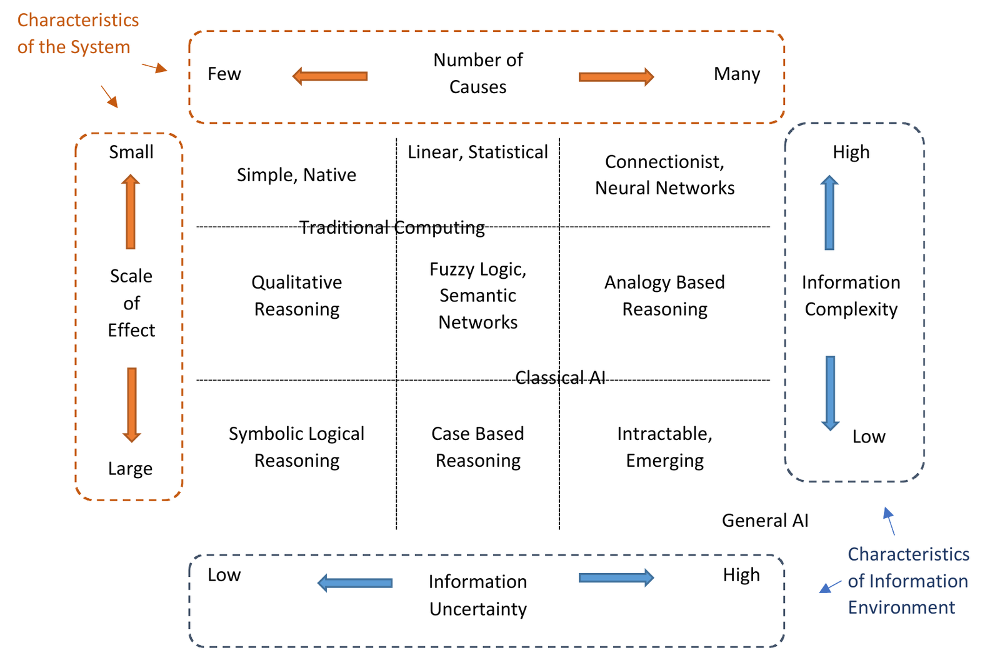
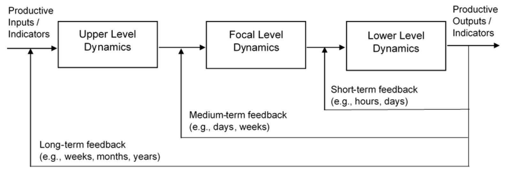

```{=html}
<header class="page-hero container"><p class="eyebrow">Behavioural economics · AI · Complex systems</p><h1>Research</h1><p class="lead">My research examines how technologies, people and institutions evolve together. I use complexity science and behavioural economics to connect individual decisions, organisational change and wider social and economic outcomes.</p></header>
<div class="container reading-layout">
  <aside class="page-aside research-aside">
    <div class="aside-nav-group"><p class="eyebrow">Research themes</p><nav aria-label="Research themes"><a href="#human-ai">Human–AI interaction</a><a href="#technology-adoption">Technology adoption &amp; work</a><a href="#knowledge-systems">Knowledge discovery</a><a href="#complex-systems">Complex systems</a><a href="#methods">Methods &amp; approaches</a></nav></div>
    <div class="aside-nav-group"><p class="eyebrow">Reach &amp; collaboration</p><nav aria-label="Research reach and collaboration"><a href="#research-impact">Citations &amp; readership</a><a href="#policy-engagement">Policy &amp; public engagement</a><a href="#collaboration">Research collaborations</a></nav></div>
    <p class="aside-note">A complexity science of technological evolution: how individual behaviour, organisations and institutions shape—and are shaped by—technological change.</p>
  </aside>
  <div class="prose">
    <section class="prose-section topic-row" id="human-ai"><span class="theme-number" aria-hidden="true">01</span><div><h2>Human–AI interaction and evaluation</h2><p>How well can generative AI represent human values, attitudes, preferences and decisions? I investigate synthetic populations, or <em>silicon sampling</em>, through comparisons with human evidence, sensitivity analysis and cross-model evaluation.</p><p>This includes questions of cultural alignment, population heterogeneity, public opinion and organisational judgement. I’m interested in which research questions synthetic respondents can help address, and how to recognise the variation and uncertainty that their responses may miss.</p><p><strong>Selected work</strong><br><a href="https://doi.org/10.48550/arXiv.2308.00521">SurveyLM technical report ↗</a><br><a href="https://doi.org/10.1108/JSM-11-2023-0441">Comparing human and synthetic data in service research ↗</a><br><a href="https://theconversation.com/ai-can-predict-how-youll-respond-to-a-survey-but-thats-not-the-same-as-understanding-you-287069">AI prediction and human understanding · The Conversation ↗</a></p></div></section>
    <section class="prose-section topic-row" id="technology-adoption"><span class="theme-number" aria-hidden="true">02</span><div><h2>Technology adoption, work and capability</h2><p>Why do some workers and organisations adopt new technologies productively while others face barriers, risks or uneven benefits? I combine behavioural and institutional analysis with labour-market evidence, skill networks and models of adaptation.</p><p>I led the Future Skills Organisation’s national study of generative AI adoption by Australian workers, engaging a working group spanning government, employers, unions and professional bodies. Current research extends these questions to occupational mobility, capability evolution, professional identity and the ways institutions shape technological change.</p><p><strong>Selected work</strong><br><a href="projects.html#ai-adoption">National AI-adoption study &amp; employer toolkit →</a><br><a href="https://doi.org/10.1111/joes.12611">AI and big data in sustainable entrepreneurship ↗</a><br><a href="projects.html#other-research">AI copilots, work &amp; professional identity →</a></p></div></section>
    <section class="prose-section topic-row" id="knowledge-systems"><span class="theme-number" aria-hidden="true">03</span><div><h2>Finding evidence in archives and interviews</h2><p>I build research software for searching and analysing documents, archives and interviews. It combines semantic retrieval and language models with structured extraction and knowledge graphs, keeping results linked to the original material.</p><p>Projects include historical Spanish Inquisition records, scientific interviews through Web of Stories, and AI-assisted qualitative analysis. Researchers need to be able to check what the software has extracted against the source.</p><p><strong>Selected work</strong><br><a href="projects.html#knowledge-platforms">Archival research &amp; scientometrics platforms →</a><br><a href="projects.html#other-research">RiskWise qualitative-analysis workflow →</a></p></div></section>
    <section class="prose-section topic-row" id="complex-systems"><span class="theme-number" aria-hidden="true">04</span><div><h2>Complex systems and behavioural economics</h2><p>I study technological evolution as a complex adaptive process: people learn and make decisions, organisations develop capabilities, and institutions shape which changes persist. These micro, meso and macro levels influence one another through networks, feedback and adaptation.</p><p>My PhD brought behavioural economics and complexity science together to study interacting agents and limited information. That perspective now informs my work on workforce transitions, AI, digital platforms, public health, financial markets and mobility.</p><p><strong>Selected work</strong><br><a href="https://doi.org/10.5204/thesis.eprints.244769">Bridging Complexity and Behavioural Economics · PhD thesis ↗</a><br><a href="https://doi.org/10.1007/s11192-022-04294-w">Artificial intelligence in the field of economics ↗</a><br><a href="https://doi.org/10.1007/s00146-022-01452-9">Cognitive architectures for artificial intelligence ethics ↗</a></p></div></section>
    <section class="prose-section" id="methods"><p class="eyebrow">How I work</p><h2>Methods &amp; approaches</h2><p>I choose methods around the question, the scale of the system and the available evidence. That often means combining empirical analysis with computational models, then checking how sensitive the results are to the assumptions.</p><ul><li><strong>Behaviour and evidence:</strong> surveys, experiments, behavioural economics, statistics and econometrics.</li><li><strong>Systems and structure:</strong> agent-based modelling, network analysis, scientometrics, geospatial and mobility analysis.</li><li><strong>AI and software:</strong> machine learning, model evaluation, retrieval-augmented generation, structured extraction and human review.</li></ul><h3 id="doctoral-research">The Constrained Methods Matrix</h3><p>My PhD thesis, <em>Bridging Complexity and Behavioural Economics</em> (QUT, 2023), developed a framework for choosing methods for complex problems. The Constrained Methods Matrix relates nine broad families of analytical methods to the number of causes involved, the scale of their effects, and the complexity and uncertainty of the information available.</p><p>The framework grew out of work with Professor Benno Torgler, building on ideas from Marvin Minsky, Aaron Sloman and Push Singh. Its boundaries are deliberately soft: statistical, qualitative and case-based reasoning may be useful together, and collecting different data can make other approaches feasible.</p><p>I also consider feedback between levels of a system. Individual behaviour can change an organisation, while organisational rules shape what individuals can do; these effects unfold at different speeds. The relevant focal level might be a workplace, a sector or a region.</p><details class="method-figures"><summary>View the methods matrix and feedback diagram</summary><div><figure class="research-figure"><a class="figure-link" href="assets/images/research/cmm-matrix.png" data-figure-title="The Constrained Methods Matrix" aria-label="Enlarge: The Constrained Methods Matrix"><span class="figure-hint">View larger <span aria-hidden="true">↗</span></span></a><figcaption><strong>Figure 1 · The Constrained Methods Matrix, extended version.</strong> Thesis p. 13, adapted from Bickley &amp; Torgler (2023). <a href="https://doi.org/10.5204/thesis.eprints.244769">Thesis and source context ↗</a></figcaption></figure><figure class="research-figure"><a class="figure-link" href="assets/images/research/nested-feedback.png" data-figure-title="Feedback across levels of a system" aria-label="Enlarge: Feedback across levels of a system"><span class="figure-hint">View larger <span aria-hidden="true">↗</span></span></a><figcaption><strong>Figure 5 · Nested feedback loops.</strong> Thesis p. 56. The chapter draws on hierarchical systems work by Simon (1962) and Ceddia et al. (2013). <a href="https://doi.org/10.5204/thesis.eprints.244769">Thesis and source context ↗</a></figcaption></figure></div></details><p>In the thesis, I applied this perspective to public health, financial markets, mobility and the development of AI. <a href="https://doi.org/10.5204/thesis.eprints.244769">Read the complete thesis ↗</a></p><p class="note">My software work includes Python, R, Stata, MATLAB, SQL/PostgreSQL, Django REST Framework, React, Streamlit, API integration and AWS-hosted research applications.</p></section>
    <section class="prose-section" id="research-impact"><p class="eyebrow">Research reach</p><h2>Citations and readership</h2><p>My work is read across economics, AI, public health and related fields. The figures below identify the source and the date it was last checked.</p><dl class="impact-metrics"><div><dt>Google Scholar citations</dt><dd><span data-metric="scholar.citations">738</span><small>Checked <time data-metric-date="scholar" datetime="2026-10-29">29 October 2026</time></small></dd></div><div><dt>Google Scholar h-index</dt><dd><span data-metric="scholar.h_index">9</span><small>Checked <time data-metric-date="scholar" datetime="2026-10-29">29 October 2026</time></small></dd></div><div><dt>Field-weighted citation impact</dt><dd><span data-metric="scival.fwci">4.70</span><small>SciVal · <time data-metric-date="scival" datetime="2026-02">February 2026</time> snapshot</small></dd></div></dl><p class="metric-source">Google Scholar and the public publisher counters are checked weekly; the dates record the last successful refresh. <a href="https://scholar.google.com/citations?user=ARJITb8AAAAJ&amp;hl=en">View my current Google Scholar profile ↗</a>. SciVal is a dated institutional snapshot, rather than a live counter.</p><div class="paper-reach"><article><h3><a href="https://link.springer.com/article/10.1007/s11192-022-04294-w">Artificial intelligence in the field of economics</a></h3><p><strong><span data-metric="ai-economics.accesses">53k</span> publisher accesses</strong> · Altmetric attention score <span data-metric="ai-economics.altmetric">16</span></p><p>Our study of how AI methods spread through economics.</p><p class="metric-source">Publisher checked <time data-metric-date="ai-economics" datetime="2026-10-29">29 October 2026</time>.</p></article><article><h3><a href="https://link.springer.com/article/10.1007/s00146-022-01452-9">Cognitive architectures for artificial intelligence ethics</a></h3><p><strong><span data-metric="ai-ethics.accesses">14k</span> publisher accesses</strong> · Altmetric attention score <span data-metric="ai-ethics.altmetric">10</span></p><p>Work with Benno Torgler on understanding the reasoning behind AI decisions.</p><p class="metric-source">Publisher checked <time data-metric-date="ai-ethics" datetime="2026-10-29">29 October 2026</time>.</p></article></div><p class="metric-source">Access counts retain the publisher’s rounded display; they are not unique readers. Accesses, citations and attention scores describe different kinds of engagement. Values remain dated if a source is unavailable.</p></section>
    <section class="prose-section" id="policy-engagement"><p class="eyebrow">Policy and public engagement</p><h2>Where the research is being used</h2><h3>Employer resources and government evidence</h3><p>The Future Skills Organisation study led to a national report, employer workshops and resources for organisations introducing generative AI. My work with IP Australia linked job advertisements, firm information and patent records to study AI investment.</p><p><a href="projects.html#ai-adoption">FSO study and employer resources →</a><br><a href="https://www.futureskillsorganisation.com.au/sme-ai-coach/">Download FSO’s SME AI Coach ↗</a><br><a href="https://www.ipaustralia.gov.au/tools-and-research/professional-resources/data-research-and-reports/publications-and-reports/drivers-of-ai-investment">IP Australia: Drivers of AI Investment ↗</a></p><h3>Citations in policy-facing research</h3><p>My research has been cited in IZA discussion papers on AI and its economic implications. Two examples are:</p><ul><li><a href="https://docs.iza.org/dp17055.pdf"><em>Artificial Intelligence and Entrepreneurship</em></a> (Fossen, McLemore &amp; Sorgner, 2024), which cites our sustainable entrepreneurship research.</li><li><a href="https://docs.iza.org/dp15713.pdf"><em>The Future Economics of Artificial Intelligence: Mythical Agents, a Singleton and the Dark Forest</em></a> (Naudé, 2022), which cites our study of AI in economics.</li></ul><p>These citations show the work contributing to wider policy discussions. The commissioned projects provide more direct examples of research being developed into resources for government and employers.</p><h3>Writing for a wider audience</h3><p>I’ve written about synthetic respondents for <em>The Conversation</em> and co-authored public pieces on COVID-19 and the environment for the Nature research community.</p><p><a class="text-link" href="publications.html#public-writing">Read the articles and engagement figures <span aria-hidden="true">→</span></a></p></section>
    <section class="prose-section" id="collaboration"><p class="eyebrow">Working across disciplines</p><h2>Research collaborations</h2><p>I work with researchers, students and practitioners across universities, government and industry. The collaborations range from joint papers and student supervision to software development, commissioned studies and resources for employers.</p><h3>Universities and research organisations</h3><p>At QUT, I work with ARC BITA, the Energy Transition Centre, the Centre for Data Science and eResearch. Collaborators are also based at the University of Western Australia, Universidad de Oviedo, Universidade da Coruña, UNSW, Maastricht University, Universität Tübingen, the University of Kassel and Griffith University.</p><p>Other research connections include CREMA, the Laboratory for Innovation Science at Harvard, WHU – Otto Beisheim School of Management, the University of Fribourg and CSIRO / Data61. My international exchanges have also involved the University of Economics Ho Chi Minh City and RMIT Vietnam.</p><h3>Government, industry and health</h3><p>Selected collaborators and project partners include Future Skills Organisation, IP Australia, the Queensland Department of the Premier and Cabinet, Queensland Department of Transport and Main Roads, Inspired Education Australia, Verbrec, Suncorp, Stryker Trauma, Impect, Metro South Health and Princess Alexandra Hospital.</p><p>The FSO project also drew on a national working group with representatives from government, major employers, unions, industry and small-business bodies, including the Digital Transformation Agency, Commonwealth Bank, Woolworths Group, the Australian Council of Trade Unions and COSBOA. <a href="projects.html#ai-adoption">Project, team and working-group details →</a></p><p class="note"><a href="projects.html">Named contributors and their roles are credited with each project.</a></p><a class="text-link" href="about.html#contact">Discuss a research collaboration <span aria-hidden="true">→</span></a></section>
  </div>
</div>
```
