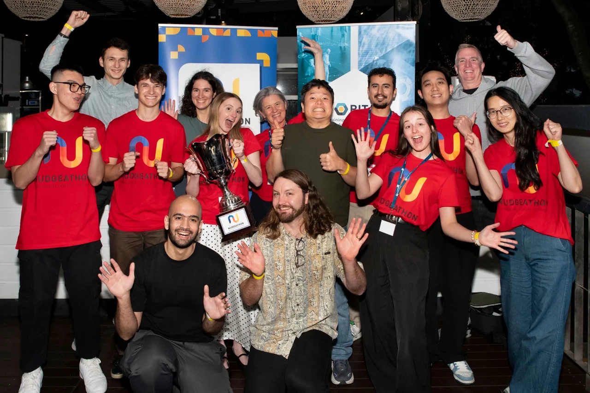
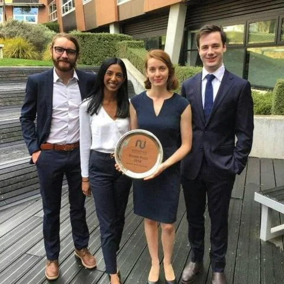
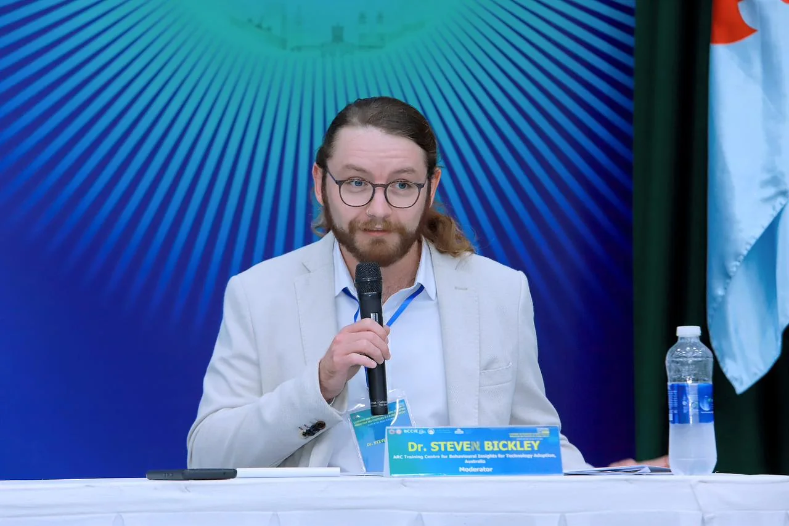

```{=html}
<header class="page-hero container"><p class="eyebrow">Teaching, supervision &amp; sharing</p><h1>Teaching and supervision</h1><p class="lead">I teach economics and research methods. In class, I use worked examples and demonstrations to connect a method’s assumptions with the questions it can help answer.</p></header>
<div class="container reading-layout">
  <aside class="page-aside"><p class="eyebrow">Learning &amp; community</p><nav aria-label="On this page"><a href="#university-teaching">University teaching</a><a href="#open-resources">Open research resources</a><a href="#supervision">Supervision &amp; mentoring</a><a href="#nudgeathon">Nudgeathon community</a><a href="#speaking">Invited speaking &amp; panels</a></nav><p class="aside-note">Interested in research training or supervision? <a href="about.html#contact">Get in touch.</a></p></aside>
  <div class="prose">
    <section class="prose-section" id="university-teaching"><p class="eyebrow">Queensland University of Technology</p><h2>University teaching</h2><h3>EFB350 · Data Capture and Research Design</h3><p class="role">Co-Developer, Co-Coordinator &amp; Lecturer · Undergraduate · 2024–2025</p><p>I helped develop and deliver a 13-week interdisciplinary unit informed by the methods framework from my doctoral research. Students explored experimental and survey design, narrative and content analysis, networks, agent-based modelling, biosensors, remote sensing, online data collection and generative AI.</p><p>Practical activities connected research principles with R, Qualtrics/SMARTRIQs, LIWC-22, Gephi, NetLogo, Python and AI APIs. I contributed to curriculum, learning outcomes, assessment, teaching coordination and formal peer review of the learning environment.</p><h3>EFN405 · Applied Economics</h3><p class="role">Tutor &amp; Canvas Coordinator · Postgraduate · 2023–2024</p><p>Postgraduate tutorials, online learning materials, assessment, marking and feedback, with an emphasis on applying economic reasoning to practical problems.</p><h3>BSB113 · Economics</h3><p class="role">Tutor · Undergraduate · 2022</p><p>Introductory economics tutorials helping students connect foundational principles with real-world examples and build analytical confidence.</p><h3>Engineering academic support</h3><p class="role">Sessional Academic Success Program · 2018</p><p>Targeted individual and small-group support in advanced engineering mathematics, electronic design, and electromagnetics and machines.</p></section>
    <section class="prose-section" id="open-resources"><p class="eyebrow">Workshops and open resources</p><h2>Sharing research tools</h2><div class="callout"><h3>ARC BITA Geek Seminar Series</h3><p>I co-founded and coordinate this practical seminar series on empirical methods and technologies for behavioural insights and technology adoption. I developed and maintain its public GitHub knowledge hub, preserving slides, code demonstrations, recordings where available and further reading.</p><a class="text-link" href="https://github.com/stevejbickley/arcbita-geek-seminars">Browse the knowledge hub <span aria-hidden="true">↗</span></a></div><h3>Synthetic data and silicon sampling</h3><p>I designed and delivered a five-part ARC BITA research-skills workshop series in May–October 2024, covering synthetic respondents, language-model-based research, experimental design, evaluation and responsible use.</p><h3>AI for academic research</h3><p>My invited University of Western Australia lecture in April 2025, “How Can I Use AI to Help My Academic Research?”, brought together more than 120 participants in person and online.</p></section>
    <section class="prose-section" id="supervision"><p class="eyebrow">Research development</p><h2>Supervision and mentoring</h2><p>My supervision spans applied AI, behavioural economics, computational methods, information systems and technology adoption. Depending on the project, I help with study design and analysis, computational models or software, and preparing the work for publication.</p><p>As of October 2026, I have held <strong>eight Associate Supervisor appointments</strong>, including an MPhil candidate who completed in August 2026 and subsequently progressed to doctoral study.</p><p>I also mentor research assistants, software developers and student project teams, and contribute to Mansfield State High School’s Digital Solutions Mentorship Program. I welcome enquiries where research interests and institutional supervision arrangements align.</p></section>
    <section class="prose-section" id="nudgeathon"><p class="eyebrow">Behavioural science, together</p><h2>The Nudgeathon community</h2><p>Nudgeathons have been part of my journey from student competitor to mentor and coach. As a coach, I help teams work through the behavioural evidence and the practical limits of their proposals.</p>
<div class="event-gallery event-gallery--nudgeathon">
<figure><a class="photo-link" href="assets/images/events/nudgeathon-2026.webp" data-figure-title="Nudgeathon 2026 · Brisbane" aria-label="Enlarge: Nudgeathon 2026 · Brisbane"></a><figcaption>With HDR students, postdocs and colleagues at Nudgeathon 2026 · Brisbane, Australia</figcaption></figure>
<figure><a class="photo-link" href="assets/images/events/nudgeathon-2018.webp" data-figure-title="Australian Nudgeathon 2018 · Second place" aria-label="Enlarge: Australian Nudgeathon 2018 · Second place"></a><figcaption>Our team placed second at the second annual Australian Nudgeathon · 2018</figcaption></figure>
</div>
<ul class="timeline"><li><time>2025–2026</time><div><h3>Domain expert, advisor &amp; coach</h3><p>Supported 12 teams from Australian universities and government departments across the QUT-hosted Nudgeathons, including the 2026 event in Brisbane.</p></div></li><li><time>2023–2024</time><div><h3>Coaching QUT undergraduate teams</h3><p>People’s Choice Award in 2023 and third place in 2024.</p></div></li><li><time>2022</time><div><h3>Mentoring a winning team</h3><p>PhD mentor for the QUT team that placed first at the Nudgeathon hosted by the Australian National University.</p></div></li><li><time>2018</time><div><h3>Second place as a competitor</h3><p>Member of the team that placed second at the second annual Australian Nudgeathon, working on the Australian Taxation Office challenge.</p></div></li><li><time>2017</time><div><h3>People’s Choice Award</h3><p>Department of Human Services Nudgeathon challenge.</p></div></li></ul></section>
    <section class="prose-section" id="speaking"><p class="eyebrow">Invited talks &amp; international exchange</p><h2>Invited talks and panels</h2><figure class="image-inset"><figcaption>Facilitating an invited panel at SEAMEO RETRAC · Ho Chi Minh City, Vietnam · October 2024</figcaption></figure><h3>Higher education leadership and emerging technology</h3><p>At the International Conference on Leadership and Management in Higher Education, SEAMEO RETRAC, on 15 October 2024, I moderated two invited panels:</p><ul><li>“Leadership and Entrepreneurship in Higher Education: Strategic Approaches and Best Practices.”</li><li>“Design, Implementation and Assessment of Innovative Technologies in Higher Education: Artificial Intelligence and Emerging Technologies.”</li></ul><h3>Selected speaking engagements</h3><ul><li><strong>2026:</strong> creativity and emotion in sports economics, Economic Society of Australia (Tasmania); AI-driven corporate foresight, AusiSTAR / Next Generation Graduates symposium at QUT; technology careers, Mansfield State High School.</li><li><strong>2025:</strong> quantum computing and sport, Quantum Meets @ QUT; quantum in sport and engagement with Europe, EU economic and commercial counsellors delegation; AI for academic research, UWA.</li><li><strong>2024:</strong> AI-driven disaster management and resilience, Queensland Disaster Management Research Advisory Panel.</li><li><strong>2023:</strong> augmented language models, Something Fest in Brisbane; generative AI in engineering, EDL Engineering National Forum; synthetic society, Queensland Department of Transport and Main Roads.</li></ul></section>
  </div>
</div>
```
